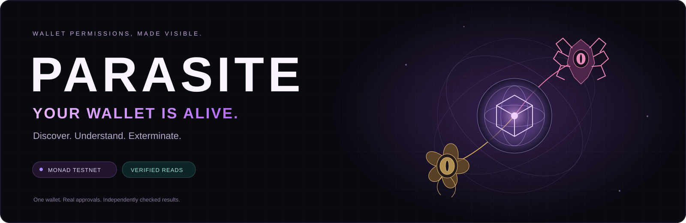
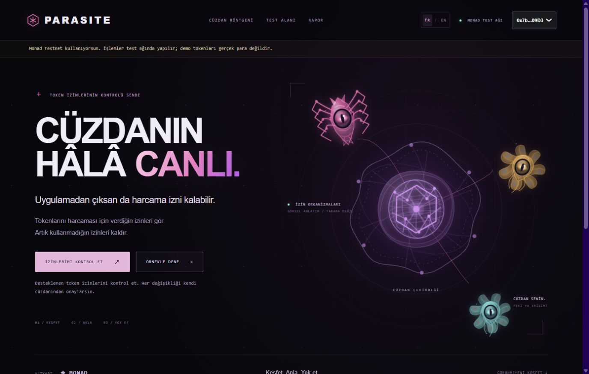
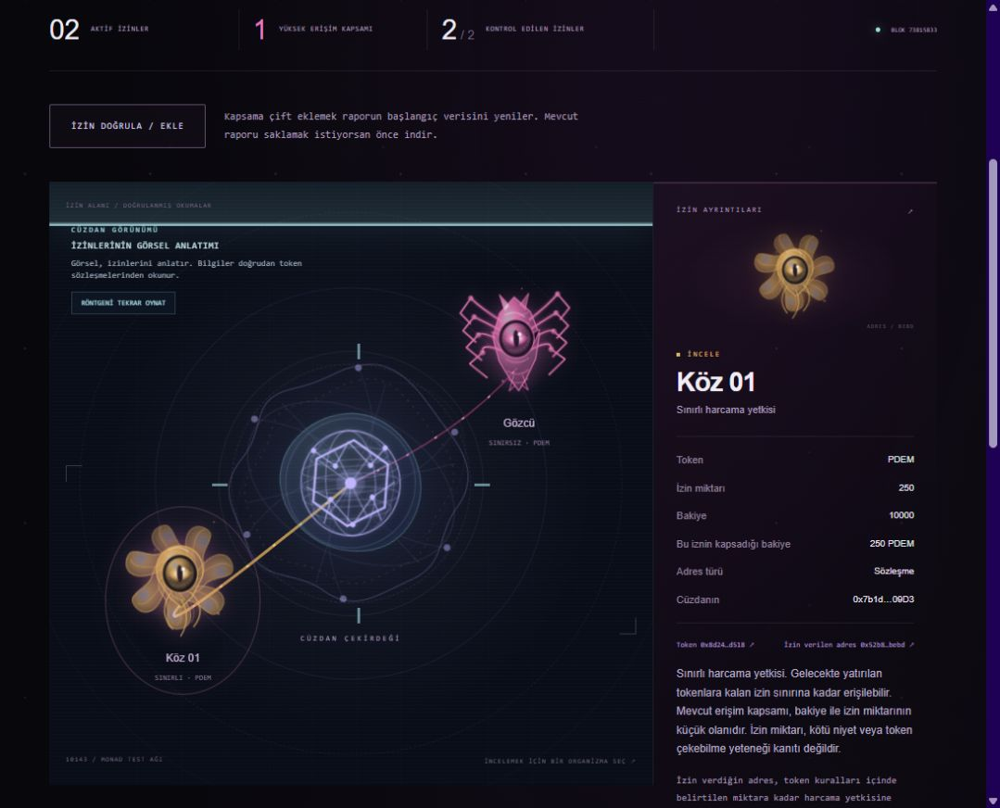
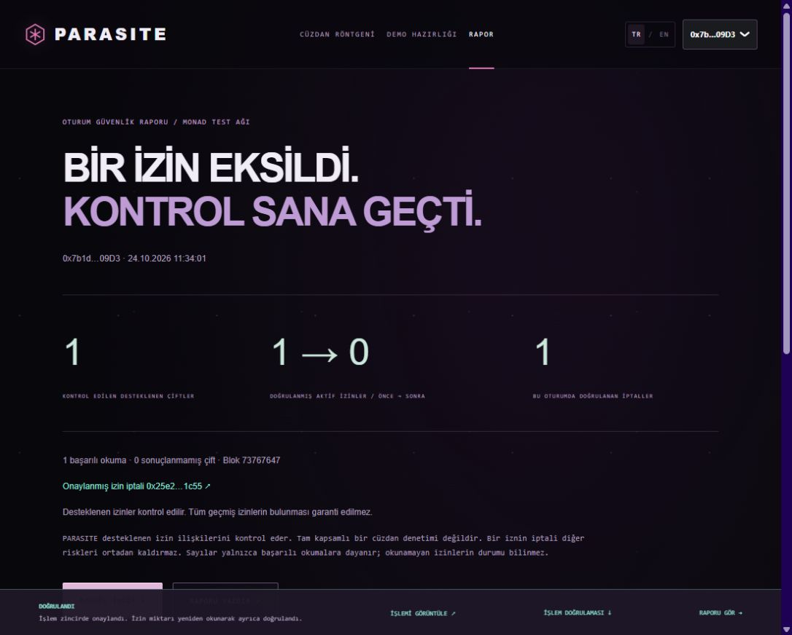
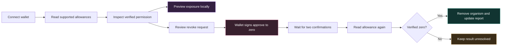

<div align="center">



<p><strong>See who can spend your tokens. Remove access you no longer need.</strong></p>

<a href="https://github.com/Pentamatra/PARASITE"></a>


**English** · [Türkçe](README.tr.md)

[The experience](#the-experience) · [Quick start](#quick-start) · [Contracts](#deployed-contracts) · [How it works](#how-it-works) · [Verification](#verification)

</div>

> [!IMPORTANT]
> PARASITE currently runs on **Monad Testnet**. Demo tokens have no monetary value. It checks supported approval relationships; it is **not a full wallet security audit**.

## The permission you forgot about

Disconnecting a wallet from an app does **not** automatically remove the token spending permission you previously gave it.

That permission can remain in the token contract long after you leave. PARASITE makes it visible: each active approval becomes a living organism connected to your wallet core. Inspect the permission, understand its scope, and remove it through your own wallet.

**The creature is a visual metaphor for permission—not a verdict that an app is malicious.**



## The experience

### 🟣 Discover — look inside your wallet

Connect a wallet and check supported token/address relationships. PARASITE reads their current allowances directly from contracts. Positive, verified allowances appear around the wallet nucleus; zero allowances stay in the inventory without becoming active creatures.

### 🟠 Understand — meet Gözcü and Köz

- **Gözcü / The Overseer:** the demo's unlimited spending authorization. With a positive balance, it illustrates high exposure and explains why future deposits may also fall within scope.
- **Köz / Ember:** a separate, limited **250 PDEM** authorization. Removing Gözcü's allowance does not change Köz's allowance.

Select either organism to inspect the token, approved address, balance, allowance, and verification block. The X-ray and exposure animation explain the permission; they never move tokens.



<sub>Captured during a real testnet session. Screenshots are historical observations; current allowances may differ. Full wallet addresses are hidden in the interface by default.</sub>

### 🟢 Remove — verify the change

Review the request and confirm it in your wallet. PARASITE calls **`approve(spender, 0)` on the token contract**, waits for two confirmations, then reads the allowance again. The creature disappears only after the allowance is verified as zero.

The session report shows supported relationships checked, active approvals before/after, verified revocations, and transaction links. Export an SVG card, JSON data, or a printable report.

<details>
<summary><strong>See a real confirmed revocation report</strong></summary>



This earlier session verified **1 → 0** active approvals. It is not a security score or a claim that all wallet risks were removed. The image shows an earlier interface revision; the underlying transaction is linked below.

</details>

## What is implemented

- **One-wallet workflow:** connect, inspect, approve test tokens, revoke, and verify.
- **English + Turkish:** localized navigation, explanations, and transaction states.
- **Known-contract discovery:** pinned-block allowance reads with explicit coverage.
- **Add your own relationship:** verify a token and spender address before adding it.
- **Bounded event discovery:** scan recent Approval events for one token, then re-read current allowances.
- **Explainable exposure:** exact `bigint` calculations, without invented prices or reputation.
- **Resilient transactions:** simulation before signing, intent verification, replacement handling, and post-receipt reads.
- **Recovery:** saved public transaction metadata, reload recovery, bounded RPC visibility retries, and read-only hash recovery when a wallet broadcasts without responding.
- **Local change comparison:** optional browser-only snapshots; refreshed manually, not continuous protection.
- **Lightweight visuals:** procedural SVG organisms, X-ray light, animated tendrils, reduced motion, and a mobile creature grid.

## Quick start

**Requirements:** Node.js **18.18 or newer** as declared by the repository, Yarn **3.2.3**, and a browser wallet for live transactions. The lockfile pins dependencies; this project preserves the Monad Scaffold-ETH stack.

From the repository root in Windows PowerShell:

```powershell
yarn.cmd install --immutable
yarn.cmd start
```

Open **[localhost:3000](http://localhost:3000)**.

On other shells, use `yarn` instead of `yarn.cmd`. The illustrative example works without signing; live reads require a connected wallet, and writes require Monad Testnet plus test MON for gas.

<details>
<summary><strong>Environment variables</strong></summary>

Copy `packages/nextjs/.env.example` to `packages/nextjs/.env.local` if overrides are needed.

- `NEXT_PUBLIC_WALLET_CONNECT_PROJECT_ID` — your WalletConnect project ID for WalletConnect connections.
- `NEXT_PUBLIC_MONAD_RPC_URL` — optional Monad Testnet RPC override.
- `NEXT_PUBLIC_PARASITE_TOKEN` — optional confirmed demo token address.
- `NEXT_PUBLIC_PARASITE_SPENDERS` — optional comma-separated confirmed demo spender addresses.

The two deployed demo relationships are already recorded in [`deployment.json`](packages/nextjs/lib/parasite/deployment.json). Allowances are always read again from the chain.

**Never put a private key in a `NEXT_PUBLIC_` variable.** Hardhat signer settings belong only in `packages/hardhat/.env`; see [the developer guide](docs/DEVELOPMENT.md).

</details>

## Try it with one wallet

1. Connect your wallet and switch to **Monad Testnet, chain 10143**.
2. Open **Test Area / Test Alanı**. Your wallet needs test MON for fees and PDEM for a nonzero balance illustration.
3. Explicitly create Gözcü's unlimited allowance and Köz's 250 PDEM allowance. Each request needs your wallet confirmation; nothing is approved automatically.
4. Open **Check My Permissions / İzinlerimi Kontrol Et**. Confirm that two active permissions were read successfully.
5. Inspect both organisms, then open the exposure visualization. It is labeled as a simulation and sends no transaction.
6. Remove **Gözcü's** permission and sign in your wallet. Wait for the receipt and verified zero allowance.
7. See **Köz remain active** and open the report: **2 → 1** for that session, assuming both approvals were active at its baseline.

> [!NOTE]
> PDEM's fixed supply was minted to its deployment recipient. Connecting a different wallet does not give it PDEM. The public addresses can be read by anyone, but a meaningful funded demo requires a wallet holding these test tokens—or your own demo deployment. See [deployment and demo preparation](docs/DEVELOPMENT.md#deploy-your-own-demo).

## How it works



**Current exposure = `min(current balance, current allowance)`.** This is an illustration of token authorization scope, not a prediction of monetary loss. “Effectively unlimited” uses a documented presentation threshold of `2^255` raw units.

The blockchain is essential: approval state lives in the token contract, and removing it requires a transaction from the owner. Monad Testnet provides the network for real approvals, receipts, and independently checked state without using mainnet assets.

## Deployed contracts

**Network:** Monad Testnet · **Chain:** `10143` · **Currency:** test MON

- **PDEM / DemoToken:** [`0x8d2432d6ca3f97fc22c4fc26653fc0f90403d518`](https://testnet.monadexplorer.com/address/0x8d2432d6ca3f97fc22c4fc26653fc0f90403d518)
- **Gözcü / DemoSpender:** [`0x4ade1e3c0733b41652aa8d12c51c8b3b5dc5d0df`](https://testnet.monadexplorer.com/address/0x4ade1e3c0733b41652aa8d12c51c8b3b5dc5d0df)
- **Köz / DemoSpender:** [`0x52b8a59afd00ab49451d4722ab7594bc1b04bebd`](https://testnet.monadexplorer.com/address/0x52b8a59afd00ab49451d4722ab7594bc1b04bebd)

DemoToken uses OpenZeppelin ERC20 and mints a fixed **10,000 PDEM** supply at deployment. DemoSpender intentionally has **no withdrawal function**. The demo illustrates real token allowances, not a working drain exploit. Runtime bytecodes were compared with local compiled artifacts.

<details>
<summary><strong>Open the onchain evidence</strong></summary>

- [Real unlimited approval](https://testnet.monadexplorer.com/tx/0x58ea38700aa7b48e68726d2db0884fddd34002ef0ca38d86fbec51374a2f4355).
- [Confirmed Gözcü revocation](https://testnet.monadexplorer.com/tx/0x25e2301b5137ff5e4c008d411b97e8eebfe5b507eb02ebaee1ba2681bddc1c55): receipt block **73767546**, independent application zero read at **73767647**. This is the report pictured above.
- [Real Köz 250 PDEM approval](https://testnet.monadexplorer.com/tx/0x931d49384efb7452242be0168b8755cb83601f21dfbe97f28446582ae1639802): receipt **73814386**, independently verified at **73815245**.
- [Confirmed Köz revocation](https://testnet.monadexplorer.com/tx/0x78221cdd1bbe73ff69de55f3beda28351d3f5d130b859830ec4aada11bfba277): receipt **73816779**, zero read at **73817176**.

These are historical successful transactions, not a claim about the current allowance. All assets involved were test tokens.

</details>

## Built with

**Next.js 14 · React 18 · TypeScript · Tailwind CSS · RainbowKit · Wagmi · Viem · Solidity 0.8.20 · Hardhat · OpenZeppelin**

```text
packages/
├── nextjs/
│   ├── app/                         Next.js App Router
│   ├── components/parasite/         Experience, organisms, inspector, reports
│   └── lib/parasite/                Discovery, risk rules, transaction verification
└── hardhat/
    ├── contracts/                   DemoToken + DemoSpender
    ├── deploy/                      Guarded Monad Testnet deployment
    ├── scripts/                     Demo preparation + read-only verification
    └── test/                        Contract and TypeScript regression tests
```

No additional backend or WebGL stack is required. The original Monad, Wagmi, Viem, RainbowKit, Hardhat, debug, and block explorer infrastructure is preserved. [Starter documentation](SCAFFOLD_README.md) is retained separately.

## Verification

**Latest local validation: 78 tests passed.** Frontend and Hardhat type checks, frontend lint, and the production build passed. This is a recorded local result, not a hosted CI badge or an independent security audit.

```powershell
yarn.cmd hardhat:test
yarn.cmd next:check-types
yarn.cmd hardhat:check-types
yarn.cmd next:lint
yarn.cmd next:build
```

Tests cover finite/unlimited/zero allowances, owner isolation, independent spenders, bigint precision, partial metadata failure, failed receipts, changed transaction intent, replacement handling, missing wallet responses, and temporary RPC transaction visibility. Responsive layouts were checked at mobile, laptop, and projector widths. Real signed testnet approval/revocation flows were also completed; controlled RPC tests cover additional failure scenarios.

## Coverage and boundaries

- **Not exhaustive:** a wallet address does not expose a universal approvals list. Known relationships are checked; historical discovery is bounded and per token.
- **Unknown stays unknown:** unsupported contracts and failed reads are not treated as zero risk.
- **No maliciousness verdict:** allowance size and contract/EOA classification do not prove fraud or withdrawal capability.
- **No asset recovery:** revocation does not return stolen tokens or remove unrelated permissions and offchain signatures.
- **No continuous guard:** local comparison works on refresh; it is not an always-on monitoring service.
- **Session reports:** completed before/after history resets on reload. Pending public transaction tracking can be recovered; unknown baselines stay unknown.
- **Testnet release:** no public hosted frontend URL is claimed. Public deployment and a mainnet release have not been validated.

## Next steps

- Broader, explicitly documented token and spender coverage.
- Portable report history with independent re-verification.
- Token compatibility adapters and more wallet/browser integration tests.
- Opt-in monitoring backed by a reliable indexer with honest coverage reporting.

---

<div align="center">

**Your wallet. Your permissions. Your control.**

[Read in Turkish](README.tr.md) · [Developer guide](docs/DEVELOPMENT.md) · [Report an issue](https://github.com/Pentamatra/PARASITE/issues)

</div>
